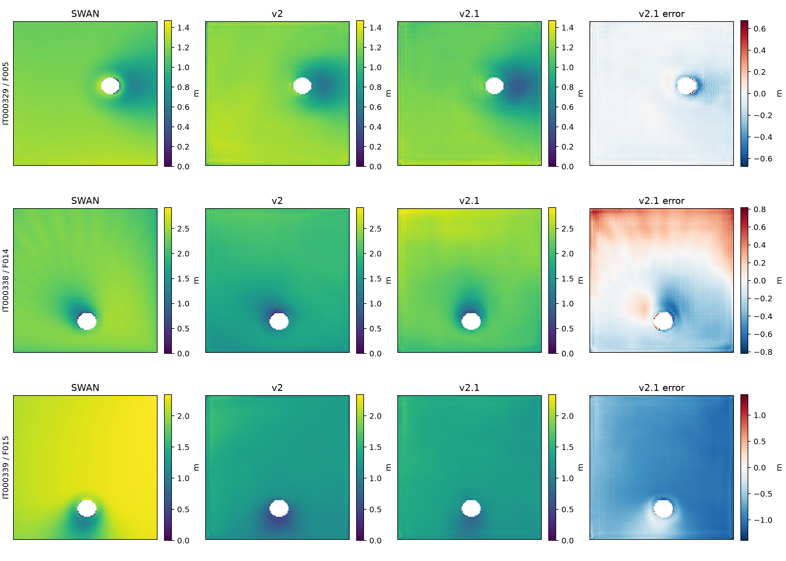

# SWAN Hs 代理模型 v2.1 结果评估

评估日期：2026-10-10。对象：本目录下 `run/` 的 80 轮正式训练和 121 个验证 case；对照为 `toy_runs/hs_unet/` 的 v2 结果。

## 1. 结论

**v2.1 是一次有明确收益的改进，值得保留为下一轮实验起点；目前仍不能判定新海况泛化已经解决。**

将首个输入通道由 `log_depth` 改为有限水深相对水深 `h/λ` 后，在这次相同训练配置、相同种子的对照中：

- 整体验证 RMSE 从 **0.48424 m 降至 0.39920 m**，下降 **17.56%**；MSE 下降 **32.04%**。
- **120/121 个 case** 的 RMSE 优于旧版，说明改进不是几个异常点造成的。
- 新岛屿组 RMSE 从 **0.10957 m 降至 0.05664 m**，下降 **48.31%**。
- F013、F014 两套新海况已在分组汇总上超过边界 Hs 插值基线。
- **F015 仍严重失效**：RMSE 为 **0.78202 m**，整体低估 **0.74575 m**，占全部验证平方误差的 **88.42%**。
- 整体 RMSE 仍高于边界插值基线 **0.33171 m**，高 **20.35%**；相对基线 MSE skill 仍为 **−0.4483**。

最准确的评价是：**熟悉海况下的新岛屿预测更好了，部分新海况的波高幅值问题得到了修正，但特定弱风涌浪组合下的幅值失效仍是主要瓶颈。**


## 2. 本次比较是否可靠

本次直接复算了两版保存的全部验证预测，并与旧版实际训练数据包核对，没有重新运行模型推理，没有修改任何权重或训练输入。

| 核查项 | 结果 |
|---|---|
| 正式训练是否完成 | 80 轮；日志、history、summary 一致 |
| 新版 best | 第 **46** 轮；独立 FP32 评估 RMSE **0.399201 m** |
| 训练内 best 验证值 | AMP 下 **0.399117 m**，与 FP32 仅差 **0.000083 m** |
| 两版 case 身份与分组 | 121 个 case 完全对应，terrain/forcing/split/generalization 一致 |
| 两版验证 target | 逐点最大差 **0** |
| 新版 target 与原数据包 y×5 | 逐点最大差 **0** |
| 验证 mask | 两版及原数据包完全一致 |
| 预测文件复算 RMSE 与 CSV | 逐 case 最大差 **0** |
| 原输入通道重建的边界基线与新版 CSV | 逐 case RMSE 最大差 **0** |
| 新版 best.pt 的 SHA256 | 与新版评估 summary 中记录一致 |
| 保存的模型配置、训练超参数 | 两版完全一致，包括 seed、80 轮、batch=8、lr=3e-4、AMP |

因此，这不是通过改变验证样本、标签、mask 或基线口径得到的“改善”。两版都是从头训练后按各自最优验证轮选择 best，旧版是 epoch 65，新版是 epoch 46。

**证据边界：**结果包没有完整新版输入数据集和完整训练源码快照。本次能够直接验证所有验证标签和输出的可比性，不能独立逐字节重验服务器 474 份新版输入。记录的新版数据签名是 `1e083e53358ddcb8725a3a538c467fb9349f71271402456b09fee4e7e1fe3bd8`。

工程另有 [本地迁移核验记录](../../experiments/v2.1/migration_verification.json)，说明当时 474 例迁移只改变 x[0]、标签及其他通道不变；但该记录的迁移后签名以 `036af041…` 开头，**不同于本次服务器训练签名**。完整签名包括元数据及 shard 字节，不同签名本身不能证明物理数组不一致，也不能直接将这份本地记录当作本次服务器数据的逐字节证明。后续应一并归档服务器的 metadata、migration_check 和代码版本。

`AUTODL_V21_GUIDE.md` 中“正式 80 轮尚未启动”是准备阶段的旧状态；这次实际结果已完成正式训练。test 尚未执行，当前所有性能结论仅针对 validation。

## 3. v2.1 改变了什么，以及结果支持到哪一步

根据当前 [迁移代码](../../TRAIN_SERVER/migrate_dataset.py)、[特征计算](../../TRAIN_SERVER/forcing_arrays.py) 和 [波长计算](../../TRAIN_SERVER/wave_geometry.py)，设计上的主要变化是：

\[
\mathrm{log\_depth}=\frac{\log(1+h/10)}{\log(1+100/10)}
\quad\longrightarrow\quad
\mathrm{relative\_depth}=\frac{h}{\lambda}=\frac{kh}{2\pi}.
\]

代码通过求解

\[
z\tanh z=\frac{(2\pi/T)^2h}{g},\qquad z=kh
\]

获得该通道。其中 T 来自输入四角 Tp 的空间插值，并非 SWAN 输出周期；没有用目标场计算该特征。零入射波高的纯风生浪 case 使用 8 秒参考周期，因此那里的 λ 是水深编码参考，不是预测出的当地风生浪波长。

这个改动显式组合了已有的水深与周期信息。原来网络需要自己从 `log_depth` 与 `wave_tp` 学出相应关系，现在输入提前提供了这种组合。**它改变了特征表达和优化路径，没有增加独立训练海况，也没有解决缺失的风生浪样本。**

结果支持“这种表达在当前对照中有效”。但由于只有一对训练种子，不能进一步声称其收益对所有初始化、地形和海况都稳定成立。也不能仅凭总体下降认定网络学会了正确的物理机制。

还有一个归因限制：这次既改变了物理变量组合，也改变了首通道的数值分布。若要研究收益是否确实来自 h/λ 的物理形式，可补充原始 h、h 与 h/λ 同时输入、通道尺度匹配等控制实验；没有必要把本轮成绩解释得超过证据。

## 4. 整体与泛化分组比较

### 4.1 整体性能

| 指标 | v2 | v2.1 | 边界 Hs 插值基线 |
|---|---:|---:|---:|
| RMSE / m | 0.48424 | **0.39920** | **0.33171** |
| MAE / m | 0.35834 | **0.25576** | **0.23263** |
| Bias / m | −0.25656 | **−0.19039** | −0.02788 |
| R² | 0.45448 | **0.62926** | **0.74402** |
| Pearson r | 0.77951 | **0.85085** | 0.86397 |
| P95 绝对误差 / m | 0.98557 | **0.95669** | **0.65002** |
| 相对边界基线 MSE skill | −1.13110 | **−0.44833** | 0 |

这里 skill 定义为 `1−MSE_model/MSE_baseline`。v2.1 的 MSE 仍为基线的 **1.4483 倍**。

平均指标明显改善，但 P95 绝对误差只下降约 **2.9%**。这与 F015 的大误差仍然存在相符：较容易的情景改善了，最难情景没有得到同等改善。

### 4.2 三类泛化

| 组别 | case 数 | v2 RMSE / m | v2.1 RMSE / m | 相对下降 | 基线 RMSE / m | v2.1 Bias / m |
|---|---:|---:|---:|---:|---:|---:|
| 新岛屿、已见海况 | 37 | 0.10957 | **0.05664** | **48.31%** | 0.34204 | −0.00452 |
| 已见岛屿、新海况 | 72 | 0.57473 | **0.47760** | **16.90%** | 0.32804 | −0.27087 |
| 岛屿和海况都新 | 12 | 0.59565 | **0.48481** | **18.61%** | 0.32072 | −0.28839 |

新岛屿组表现扎实：平均偏差接近零，全部 37 例优于基线，36 例优于旧版。新海况组仍整体落后基线，但其内部情况已经分化，不能再概括成“所有新海况都失败”。

v2.1 共 **91/121** 例优于边界基线，旧版为 39/121；其中新版新海况组有 47/72 例、两者皆新组有 7/12 例优于基线。多数 case 改善却整体仍落后，原因是少数共享同一困难海况的 case 误差幅度特别大，MSE 会显著放大这部分影响。

唯一比旧版差的 case 是 **IT000329 / T028 / F005**：RMSE 从 0.06166 增至 0.07951 m，仍优于其 0.17606 m 基线。它由轻微高估变为较明显低估，空间相关反而有所提高；不能用这一个案例否定整体改进。

## 5. 真正决定这轮成绩的是 F013、F014、F015

下表合并同一新 forcing 在旧岛、新岛上的验证样本，每个 forcing 各 28 例，按有效湿点汇总。

| 海况 | 类别 | v2 RMSE / m | v2.1 RMSE / m | 下降 | 基线 RMSE / m | v2.1 Bias / m | v2.1 skill |
|---|---|---:|---:|---:|---:|---:|---:|
| F013 | 无风涌浪 | 0.21497 | **0.11308** | **47.40%** | 0.17261 | −0.05075 | **+0.5708** |
| F014 | 同向风浪 | 0.54971 | **0.25096** | **54.35%** | 0.45272 | −0.02370 | **+0.6927** |
| F015 | 弱风涌浪 | 0.80820 | **0.78202** | **3.24%** | 0.29328 | **−0.74575** | **−6.1101** |

### 5.1 F014：这轮最大的收益来源

F014 在 v2 中将 SWAN 均值 **2.25301 m** 预测成约 **1.76223 m**。v2.1 预测为 **2.22930 m**，基本修复了大范围低估。28 个 case 全部优于旧版，也全部优于基线。

F014 贡献了两版之间**总 SSE 减少量的 73.37%**。因此本轮总体改善主要来自这一组，而不是平均分摊到所有物理情景。

但它的空间结构仍需改进。对每个 case 去掉残差均值后，剩余空间残差 RMSE 从 **0.24562 m 变为 0.24900 m**，并未下降；单 case 空间相关中位数也只是 **0.470→0.479**。可见 F014 的巨大 RMSE 收益主要是幅值修正，不等于空间分布同样改善了 54%。

### 5.2 F013：幅值之外的空间残差也明显下降

F013 的逐 case 去均值残差 RMSE 从 **0.20387 m 降至 0.09720 m**，说明不只是平移整张图的均值。新版 26/28 例超过基线。

其单 case 空间相关中位数由 0.747 微降至 0.738，提醒我们相关系数和绝对空间误差衡量不同内容：误差变小不要求相关系数同步上升。当前应综合看 RMSE、均值偏差和空间残差，而非只追求一个相关系数。

### 5.3 F015：问题基本仍在

F015 的 SWAN 平均 Hs 为 **2.02683 m**，v2.1 仅预测 **1.28107 m**，低估约 **36.8%**。28 例均略优于旧版，但没有一例超过基线。

它对全部验证 SSE 的贡献，从旧版 **64.18%** 升至新版 **88.42%**。这主要是其他海况改善后，剩余误差更加集中，并不意味着 F015 的原始 RMSE 变大。

最差 case 仍为 **IT000339 / F015**，新版 RMSE 约 **0.853 m**。对 F015 来说，深水 ≥80 m 区域 RMSE 为 **0.80127 m**，基线只有 **0.21365 m**；域内部 RMSE 也有 **0.78016 m**。因此首要问题是广泛的背景波高低估，不能归因于少数岸边像素或 padding 边缘。

上一轮审计已确认：弱风涌浪训练仅 F003/F007/F011 三套条件，其波向约 254°、238°、103°；F015 来向约 11°，风速约 1.79 m/s，且为风浪同向组合。它与同类训练海况存在明显联合条件覆盖差异。h/λ 加入水深—周期关系，却没有补上这些方向、风速、夹角组合，因此这次仍失败与原诊断相符；尚不能单凭结果证明某个特定变量或 GN 是唯一原因。

诊断性地排除 F015 后，其余 93 例新版 RMSE 为 **0.15483 m**，基线为 0.34238 m。这仅用于显示失效集中度，**不能以此剔除困难样本后宣称整体已合格**。正式结果仍是完整 121 例的 0.39920 m。



图中固定比较 IT000329/F005（唯一退化例）、IT000338/F014（幅值修复例）和 IT000339/F015（仍失效例）。两版原评估图中的 best/median 案例不同，不能把不同案例的图并排当作严格前后对比。

## 6. “波场更准确”应拆成幅值与空间结构

对每个 case 的残差 e 定义空间均值 b，有：

\[
\operatorname{mean}(e^2)=b^2+\operatorname{mean}[(e-b)^2].
\]

按各 case 湿点数加权后得到以下精确分解：

| 组别 | v2 平均偏差平方占 MSE | v2.1 占比 | v2 去均值残差 RMSE / m | v2.1 去均值残差 RMSE / m |
|---|---:|---:|---:|---:|
| 全部 | 84.79% | **81.37%** | 0.18882 | **0.17230** |
| 新岛屿 | 47.70% | **21.38%** | 0.07924 | **0.05022** |
| F013 | 10.06% | 26.12% | 0.20387 | **0.09720** |
| F014 | 80.04% | **1.55%** | 0.24562 | 0.24900 |
| F015 | 93.20% | **91.17%** | 0.21079 | 0.23239 |

这些去均值指标用到了真实标签，只是诊断分解，不能作为实际可部署的“校准后性能”。

新版的主要剩余问题仍是 case 级幅值失配，尤其 F015。与此同时，F015 的空间残差甚至上升了约 10.2%，所以解决平均偏差后也不能忽略波影形状。新海况组的单 case 空间相关中位数由 **0.708 降至 0.632**，同样不支持“所有空间结构都改善”的说法。

### 6.1 新岛屿 0.057 m 不等于岸边也有 0.057 m 精度

| 新岛屿组水深区域 | v2 RMSE / m | v2.1 RMSE / m | 基线 RMSE / m |
|---|---:|---:|---:|
| <20 m | 0.21980 | **0.20008** | 0.59040 |
| 20–80 m | 0.13910 | **0.09457** | 0.48774 |
| ≥80 m | 0.10183 | **0.04135** | 0.31559 |

新岛屿组的大幅改善主要发生在深水背景，浅水误差只降低约 9%。它仍显著优于基线，但若目标是岸边波高或岛后局部响应，不能用全域分数替代区域验收。

全部验证样本中，<20 m 的 RMSE 从 0.48120 降至 0.37238 m，20–80 m 从 0.46464 降至 0.32939 m；≥80 m 从 0.48622 降至 0.40620 m，仍落后该区 0.30578 m 基线。完整区域表见 [regions.csv](reports/regions.csv)。

## 7. 训练是否结束得太早，结果是否只是偶然低点

| 项目 | v2 | v2.1 |
|---|---:|---:|
| best epoch | 65 | **46** |
| 最后一轮验证 RMSE / m | 0.53653 | **0.41704** |
| 最后 20 轮验证 RMSE 均值 / m | 0.53501 | **0.41472** |
| 最后 20 轮范围 / m | 0.48398–0.55905 | **0.40062–0.43693** |
| 最后一轮训练日志等效 RMSE / m | 0.03282 | 0.03749 |
| 80 轮中整体超过边界基线的轮数 | 0 | **0** |

新版后期整段曲线都明显优于旧版，这比只比较两个 best 更有说服力。第 46 轮仍是选模低点，但本轮收益并不依赖这一个点：最后 20 轮平均也已降至约 0.415 m。

不过训练日志误差约 0.0375 m，验证仍约 0.417 m，泛化差距依然明显。训练值是一轮在线 batch 损失换算，不是固定 last.pt 的训练集重评成绩。继续增加 epoch 的收益尚无证据，应优先处理海况覆盖和幅值表达，而非把预算全放在延长训练上。

负 Hs 只占约 **0.00349%** 的湿点，AMP/FP32 差异也很小，二者不支持作为当前主要误差来源。

## 8. 接下来最值得做什么

### 第一：保留 v2.1，确认收益可重复

将当前 best 和本报告保存为新的比较起点。至少补充两个训练 seed，与旧表示保持相同的训练预算和选模规则，报告逐 forcing 结果。120 个 case 改善不能当作 120 份独立实验，因为它们共享少量 forcing；目前真正未见海况只有 F013、F014、F015 三套。

没有必要仅凭一次试验就删除旧方案，也没有必要马上更换大型网络。h/λ 在本轮表现出足够大的收益，值得继续研究。

### 第二：围绕 F015 暴露的条件缺口补充数据

保持当前验证 F015 不进入训练。在弱风涌浪类别中系统增加不同方向、波高、周期、弱风强度和风浪夹角的独立训练组合，并新建一组预先固定的独立验证条件。

不要只围绕 F015 一个点密集造样本后继续把同一个验证分数当作完全独立证据。F015 已经参与过两轮方案解读，应将它视为开发诊断样例，同时用新的 held-out forcing 检验覆盖改善是否普遍有效。

原有 474 例仍没有补齐：训练只有 10 套独立 forcing，纯风生浪缺失问题仍在；验证唯一纯风生浪仍是训练见过的 F008。它在新版从 0.1484 改善到 0.0461 m，**不能据此证明学会了新纯风生浪海况**。缺失样本与收敛质量需要继续按上一份审计建议处理。

### 第三：优先做保留背景幅值的对照

在同一数据上比较当前直接 Hs 输出与：

\[
\widehat H_s=H_{s,\mathrm{boundary\ interpolation}}+\Delta_\theta(X).
\]

残差头可零初始化，并保留风生增长的加性自由度。纯风生浪边界为零，不应使用会将输出锁为零的纯乘法形式。

这个实验针对 F015 的广域低估；另外比较原始海况条件分支、GN 与无 GN，可判断幅值信息是否在模型中难以利用。当前结果并没有证明 GN 是主因，也没有证明残差模型一定成功。

### 第四：单独定义空间结构验收

F014 的均值已经基本正确，下一步更应看波影、浅水区和空间残差。可在幅值指标之外增加分水深、迎浪/背浪区域误差，检查上采样纹理和局部峰值。不要因为全域 0.057 m 就认为浅水局部已经达到同样精度。

方案、分组指标及质量门槛确定后再做 test。当前 quality gates 仍为 null，test 未评估；本报告没有给出最终测试集或真实海域可用性结论。

## 9. 交付与复现

本次评估新增以下文件，原模型、训练记录与预测产物均未修改：

| 文件 | 用途 |
|---|---|
| [compare_results.py](reports/compare_results.py) | 重读全部配对验证预测，核对标签、mask、checkpoint 哈希，复算指标和画图 |
| [comparison.json](reports/comparison.json) | 一致性检查、全局/分组误差、训练曲线摘要与区域结果 |
| [paired_cases.csv](reports/paired_cases.csv) | 121 个 case 的新旧 RMSE、Bias、空间相关和 SSE |
| [groups.csv](reports/groups.csv) | 泛化组和每套 forcing 的比较、误差贡献与收益来源 |
| [regions.csv](reports/regions.csv) | 水深分区和边缘/内部区域比较 |

在工程根目录使用有 NumPy、Matplotlib 的 Python 环境运行：

```powershell
python results/v2.1_gpu_20261010/reports/compare_results.py
```

脚本读取原始数据压缩包和已保存验证预测，不解压覆盖数据，不训练，不运行 test。图表和 JSON/CSV 输出至 `reports/swan_v21_review/`。

原始证据：[新版 summary](run/evaluation/validation/summary.json)、[新版 history](run/history.csv)、[新版训练配置](run/run_config.json)、[旧版 summary](../v2_baseline_20261009/toy_runs/hs_unet/evaluation/validation/summary.json)、[上一轮完整审计](../v2_baseline_20261009/SWAN_SURROGATE_DEEP_REVIEW.md)。
