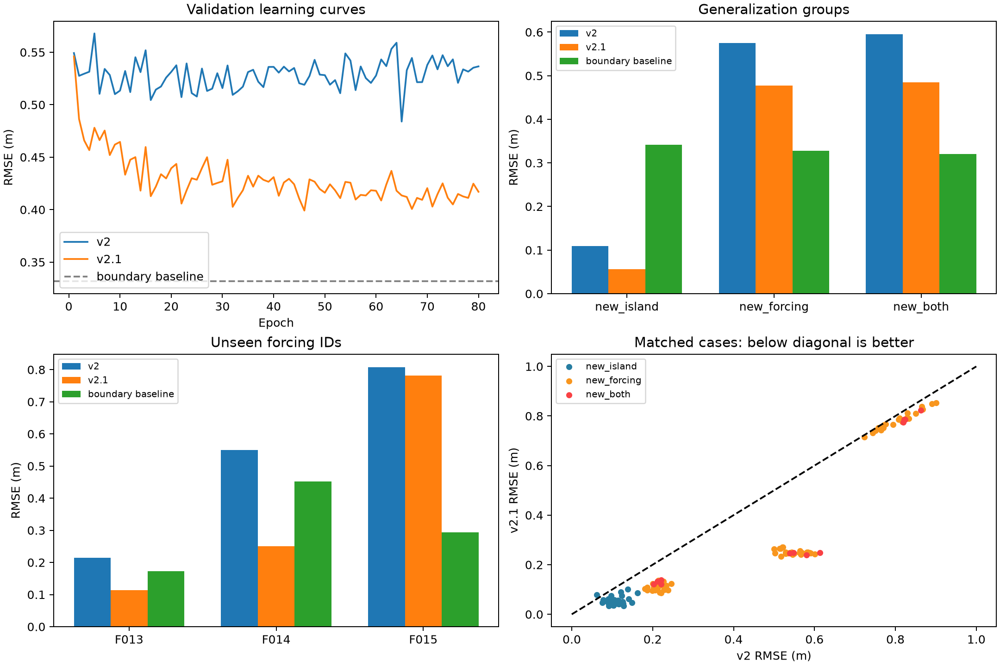

# v2.1：80 轮 GPU 对照训练与验证结果

实验日期：2026-10-10；归档日期：2026-10-12。所属分支：**`v2.1`**。

本次将首个输入通道由 `log_depth` 改为有限水深 `relative_depth = h/λ`。
其余训练设置沿用 [v2 基线](../v2_baseline_20261009/README.md)：MONAI BasicUNet、GroupNorm、seed=20261009、80 轮、batch=8、AdamW、lr=3e-4、CUDA AMP。
数据样本数为 train 227、validation 121、test 126；test 尚未运行推理评估。

## 结果

| 验证组 | v2 RMSE / m | v2.1 RMSE / m | 边界 Hs 插值 RMSE / m |
|---|---:|---:|---:|
| 全部 | 0.484239 | **0.399201** | 0.331709 |
| new_island | 0.109572 | **0.056642** | 0.342041 |
| new_forcing | 0.574728 | **0.477601** | 0.328039 |
| new_both | 0.595650 | **0.484808** | 0.320718 |

按 validation 选择第 **46** 轮 checkpoint，独立评估使用 CUDA FP32，不截断负预测。
整体 RMSE 下降 **17.56%**，120/121 个 case 优于旧版；整体 MSE skill 仍为 **−0.4483**。
F013、F014 的 RMSE 分别降至 0.11308、0.25096 m；F015 仍有 0.78202 m，平均低估 0.74575 m，占总验证 SSE 的 88.42%。
这次单种子结果支持保留 h/λ 表示继续实验，尚未证明新海况泛化已解决。



## 归档内容

- [完整训练运行](run/)：原始 best.pt、last.pt、训练配置、数据检查、80 轮 history、summary。
- [服务器训练日志](hs_unet_v21.log)。
- [原始验证报告](run/evaluation/validation/report.md)：指标、PNG 图和 121 份预测 NPZ。
- [深度评估](EVALUATION_REVIEW.md)：逐海况、幅值与空间误差、浅水分区、复现限制及下一轮建议。
- [对照审计材料](reports/)：配对 CSV、JSON、图表和适配本仓库路径的复算脚本。
- [源文件归档核验](ARCHIVE_MANIFEST.json)：源文件与归档文件的 SHA256 对应、数据签名和归档分支。
- [归档文件校验和](CHECKSUMS.sha256)：本目录所有发布文件的校验和，不包含本文件列表自身。

原始训练运行和日志按字节保留。深度评估中的相对链接已适配本目录。
本目录的 `.gitattributes` 保留文件原始字节，避免 Git 自动转换换行符导致校验和变化。
原始运行 JSON、日志及原始验证报告中的 `/root/...` 是实验时服务器路径，作为溯源记录保留。
数据压缩包保留在本地，通过独立传输交付，不包含在本结果归档中。
服务器数据签名为 `1e083e53358ddcb8725a3a538c467fb9349f71271402456b09fee4e7e1fe3bd8`。

## 复算

在仓库根目录、有 NumPy 和 Matplotlib 的环境中运行：

```bash
python results/v2.1_gpu_20261010/reports/compare_results.py
```

默认直接读取仓库内两版保存的预测与 CSV，复算配对指标、训练趋势和对比图。
输出写入 `reports/recomputed/`，该目录不参与 Git 归档。
如需重新核对原始标签和水深分区，指定本地原始基线数据包：

```bash
python results/v2.1_gpu_20261010/reports/compare_results.py --data-archive /path/to/dataset_gebco15s.tar.gz
```

不传原始数据包时，基线误差取原始逐 case CSV，不重新计算水深分区。
原审计完成的区域数据已保存在 `reports/regions.csv` 和 `reports/comparison.json`。
去掉真实标签均值偏差后的误差仅是诊断分解，不代表可部署的校准后模型精度。
